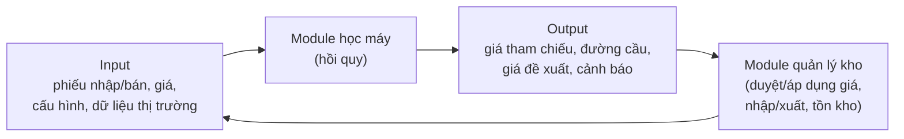
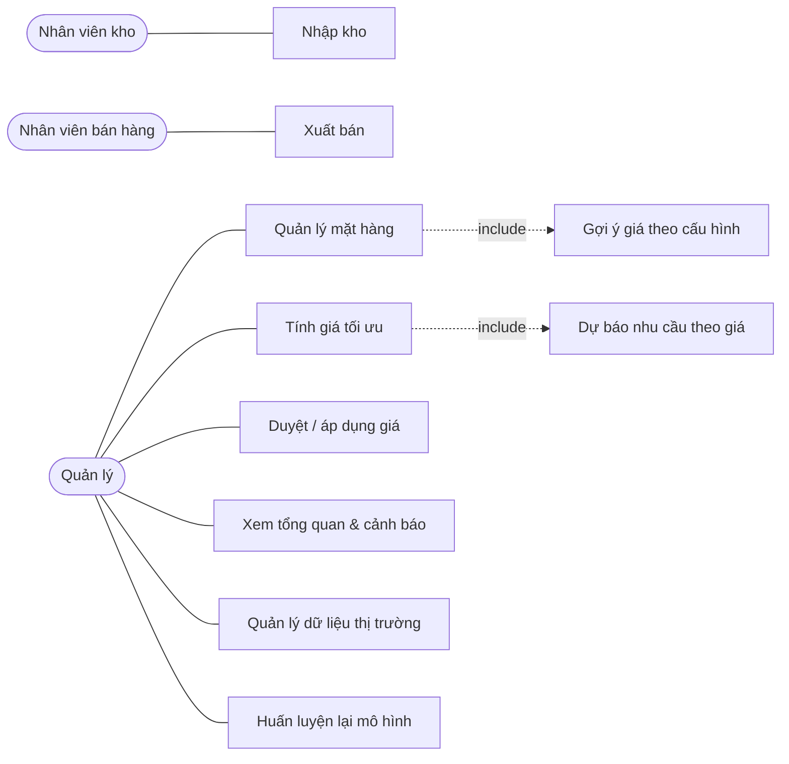
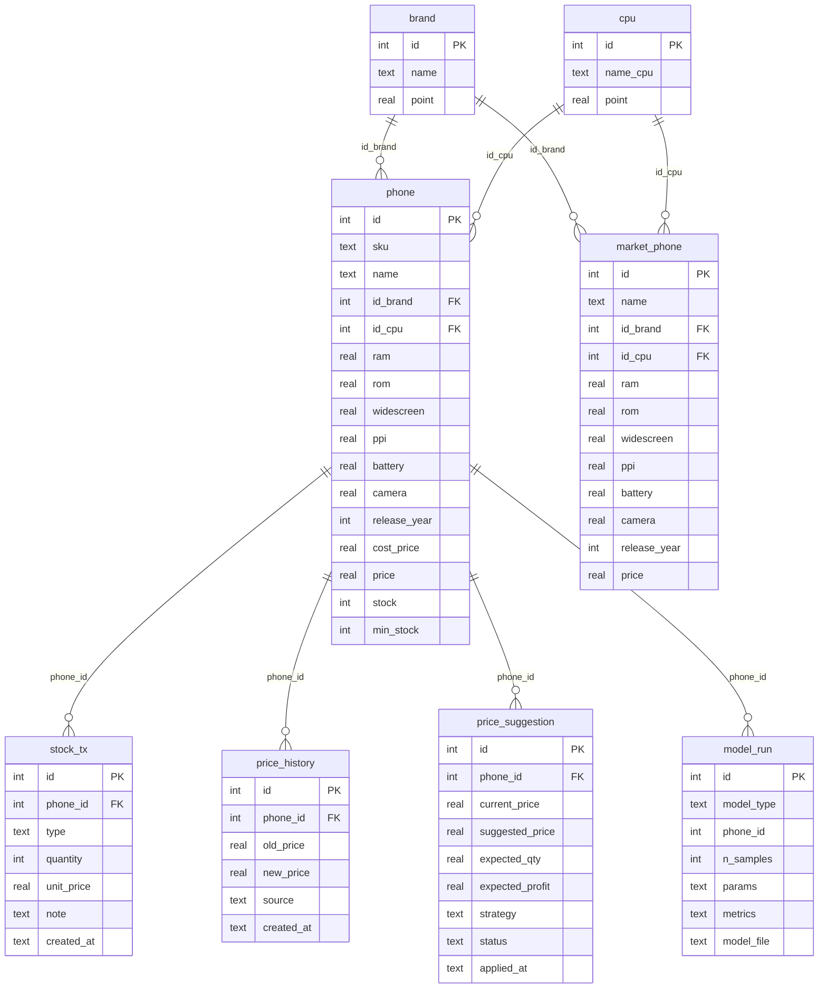

# XÂY DỰNG HỆ THỐNG QUẢN LÝ KHO MẶT HÀNG ĐIỆN THOẠI THÔNG MINH CÓ TÍNH TOÁN TỐI ƯU GIÁ BÁN BẰNG KỸ THUẬT HỒI QUY

Môn: Phát triển các hệ thống thông minh.
Sinh viên: Lại Văn Thể, MSSV K24DTCN670, lớp D24TXCN16-K.

> Báo cáo đi theo khung phân tích của bài giảng: Chương 3, Study case và Chương 4, Ví dụ minh họa. Khung gồm các bước: Tìm hiểu bài toán → Xác định mục tiêu → Thu thập dữ liệu → Xác định độ đo → Các thành phần của hệ thống → Môi trường triển khai → Kiến trúc triển khai → Kiểm thử và đánh giá.
>
> Phần hiện thực đi theo các bước của ví dụ Chương 4: Thu thập dữ liệu → Biến đổi dữ liệu → Đánh giá dữ liệu → Module quản lý kho → Module học máy (huấn luyện, lưu và nạp file tri thức, dự đoán) → Giao diện người dùng → Đánh giá hệ thống.

---

## PHẦN A. PHÂN TÍCH

### 1. Tìm hiểu bài toán

Một cửa hàng (hoặc chuỗi cửa hàng) kinh doanh điện thoại thông minh cần quản lý các việc sau:
- danh mục mặt hàng;
- nhập kho và xuất bán;
- tồn kho;
- **giá bán**.

Hiện nay giá bán thường do người quản lý đặt theo cảm tính hoặc chép giá đối thủ, dẫn đến hai tình huống bất lợi:
- **Giá quá cao**: hàng bán chậm, tồn kho lâu, vốn bị chôn. Điện thoại còn mất giá nhanh theo thời gian.
- **Giá quá thấp**: bán nhanh nhưng mất phần lợi nhuận đáng lẽ thu được.

**Thông minh có phải là cách tiếp cận phù hợp không?** Bài toán định giá rơi vào cả bốn dạng tổng quát mà Chương 3 nêu:

| Dạng bài toán (Chương 3) | Thể hiện trong bài toán định giá điện thoại |
|---|---|
| Vấn đề lớn | Mỗi cửa hàng có hàng chục mã máy. Giá tối ưu phụ thuộc nhiều biến số: giá nhập, cấu hình, thương hiệu, sức mua, tồn kho. |
| Vấn đề mở | Không có công thức cố định nào; luôn có thể bổ sung yếu tố mới như giá đối thủ, mùa vụ hay khuyến mãi của hãng. |
| Thay đổi theo thời gian | "Câu trả lời đúng hôm nay có thể sai ngày mai": máy mới ra mắt, máy cũ mất giá, sức mua thay đổi theo mùa (Tết, Black Friday). |
| Khó nội tại | Không quan sát trực tiếp được người mua phản ứng với giá ra sao; chỉ ước lượng được từ dữ liệu bán. |

Theo Chương 1, hệ thống này là một **Hệ thống hỗ trợ ra quyết định (DSS)**. Nó "cải thiện khả năng ra quyết định" về giá cho người quản lý, đi qua đủ các giai đoạn của DSS:
- **Thông minh**: phát hiện điều kiện cần quyết định, ví dụ mặt hàng tồn lâu hoặc sắp hết hàng.
- **Thiết kế**: tính các phương án giá theo từng chiến lược.
- **Lựa chọn**: người quản lý duyệt hoặc từ chối.
- **Thực hiện**: áp dụng giá mới.

Hệ thống cũng là **hệ thống cảnh báo**: nó tìm đặc trưng của dữ liệu bán để dự đoán chiều hướng tồn kho.

### 2. Xác định mục tiêu

Mục tiêu chung: *dùng trí tuệ nhân tạo (hồi quy) để đề xuất giá bán, loại trừ yếu tố cảm tính.* Diễn đạt này bám theo mục tiêu trong ví dụ Chương 4.

Chương 3 yêu cầu mục tiêu hiệu quả phải truyền đạt được kết quả mong muốn, đạt được và đo lường được. Các mục tiêu cụ thể:

| Loại | Mục tiêu | Cách đo |
|---|---|---|
| Mục tiêu tổ chức | Tăng lợi nhuận gộp/tuần của kho | So sánh lợi nhuận dự kiến ở giá hiện hành và ở giá đề xuất; sau khi áp dụng thì so với số bán thực tế |
| Mục tiêu tổ chức | Giảm hàng tồn lâu, tức số tuần đủ bán lớn hơn 8 | Chỉ số "tồn kho đủ bán (tuần)" trên trang Tổng quan |
| Kết quả người dùng | Người quản lý có giá tham chiếu khách quan khi nhập máy mới | Có hoặc không có gợi ý ngay trong form nhập |
| Mục tiêu mô hình | Mô hình định giá theo cấu hình: R² ≥ 0,8 trên tập kiểm tra | Hold-out 80/20 và k-fold (k = 5) |
| Mục tiêu mô hình | Mô hình nhu cầu: hệ số góc a < 0 và R² ≥ 0,3. Nếu không đạt thì hệ thống cảnh báo hoặc chuyển sang phương án dự phòng | R², RMSE trên dữ liệu tuần |

### 3. Thu thập dữ liệu

Theo Chương 3, dữ liệu chia làm hai nhóm: **dữ liệu khởi động (bootstrap)** và **dữ liệu sử dụng**.

| Nguồn | Bảng CSDL | Vai trò |
|---|---|---|
| Dữ liệu thị trường (khởi động): mẫu máy, cấu hình, giá tham khảo. Thu thập từ web hoặc nhập bằng CSV | `market_phone`, `brand`, `cpu` | Huấn luyện mô hình **định giá theo cấu hình** |
| Phiếu nhập và xuất bán phát sinh khi vận hành (dữ liệu sử dụng) | `stock_tx` | Tổng hợp **số lượng bán theo tuần** |
| Lịch sử thay đổi giá (nhân viên đổi, hoặc áp dụng gợi ý AI) | `price_history` | Xác định **giá có hiệu lực** của từng ngày |
| Gợi ý và quyết định của người quản lý | `price_suggestion` | Dữ liệu phản hồi. Ghi theo bộ ba của Chương 1 và 3: *ngữ cảnh* (giá cũ, tồn kho), *hành động* (áp dụng hoặc từ chối), *kết quả* (số bán thực tế sau đó) |

**Thuộc tính tạo nên giá trị sản phẩm.** Như ví dụ Chương 4, các thuộc tính gồm:
- thương hiệu (điểm 0–10);
- chip (điểm hiệu năng 0–100);
- RAM, ROM;
- kích thước màn hình, mật độ điểm ảnh (ppi);
- dung lượng pin, camera chính;
- năm ra mắt.

**Đảm bảo "dữ liệu tốt"** theo Chương 3, tức dữ liệu chứa ngữ cảnh và kết quả, phản ánh tương tác thực tế và ít thành kiến:
- Mỗi điểm dữ liệu của mô hình nhu cầu là một **tuần trọn**, gồm (giá bình quân trong tuần, số máy bán).
- **Loại bỏ các tuần có ngày hết hàng.** Trong những tuần đó số bán bị giới hạn bởi tồn kho chứ không phản ánh nhu cầu thật.
- Loại bỏ tuần đầu chưa trọn và tuần hiện tại đang dở.
- Mô hình chỉ được xây khi có ít nhất 8 tuần hợp lệ và ít nhất 2 mức giá khác nhau.

> **Lưu ý trung thực về dữ liệu mẫu.** Các tài liệu của môn học không có dữ liệu bán điện thoại, nên `app/seed.py` sinh dữ liệu khởi động như sau:
> - **Danh mục máy và giá tham khảo:** 48 mẫu máy có thật trên thị trường Việt Nam, giá tham khảo xấp xỉ. Thêm các biến thể bộ nhớ/RAM có nhiễu ±4%, tổng cộng 168 mẫu.
> - **Lịch sử bán:** 52 tuần **mô phỏng** cho 21 mặt hàng. Giá được điều chỉnh theo từng đợt. Số bán/ngày là biến ngẫu nhiên Poisson, giảm tuyến tính khi giá tăng, có hệ số mùa vụ (Tết, Black Friday, cuối tuần). Khi tồn thấp thì có nhập bổ sung.
>
> Khi triển khai thật, dữ liệu này được thay bằng dữ liệu vận hành, và hệ thống tự huấn luyện lại.

### 4. Xác định độ đo

**Độ đo mô hình.** Với y là giá trị thật, ŷ là giá trị dự đoán và n là số mẫu:

| Độ đo | Công thức | Ghi chú |
|---|---|---|
| RMSE | `sqrt( Σ(ŷ − y)² / n )` | Đúng công thức `err` trong slide *Hồi quy tuyến tính bằng polyfit* (Chương 2) |
| MSE | `Σ(ŷ − y)² / n` | |
| MAE | `Σ|ŷ − y| / n` | Sai số trung bình tính bằng đồng (VNĐ) hoặc số máy, dễ hiểu với người quản lý |
| R² | `1 − Σ(y − ŷ)² / Σ(y − ȳ)²` | Tỉ lệ biến động của y mà mô hình giải thích được |

Theo Chương 1, đây là **lỗi hồi quy (sai giá trị)**, khác với lỗi phân loại (sai nhận định).

**Độ đo vận hành (phép đo từ xa, telemetry):**
- Bảng `model_run` ghi mỗi lần huấn luyện: số mẫu, hệ số, MSE/RMSE/MAE/R² và file tri thức.
- Bảng `price_suggestion` lưu số máy bán dự kiến/tuần. Khi gợi ý đã được áp dụng ít nhất 7 ngày, hệ thống tính **số bán thực tế/tuần** để so sánh. Đây là hình thức **đánh giá trực tuyến**.
- Tỉ lệ gợi ý được *áp dụng* so với bị *từ chối* phản ánh mức tin cậy của người dùng vào hệ thống.

### 5. Các thành phần của hệ thống

Kiến trúc theo vòng lặp trong ví dụ Chương 4:



**Trải nghiệm thông minh.** Chương 3 nêu bốn yêu cầu cho trải nghiệm thông minh; hệ thống đáp ứng như sau:
1. **Thể hiện trí thông minh cho người dùng:**
   - Trang *Tối ưu giá* hiển thị giá đề xuất, mức thay đổi, số bán và lợi nhuận dự kiến, kèm đồ thị đường cầu và đường lợi nhuận.
   - Form *Thêm mặt hàng* có nút "Gợi ý giá theo cấu hình".
   - Trang *Tổng quan* cảnh báo hàng sắp hết và hàng tồn lâu, có nút "Tính giá xả kho".
2. **Đạt được mục tiêu hệ thống:** có ba chiến lược là *tối đa lợi nhuận*, *tối đa doanh thu* và *giải phóng tồn kho*.
3. **Giảm thiểu sai sót thông minh:**
   - Giá đề xuất luôn nằm trong **vùng giá an toàn**, gồm:
     - không thấp hơn giá nhập cộng biên lợi nhuận tối thiểu;
     - không vượt quá 10% ngoài vùng giá đã quan sát.
   - Khi R² thấp hoặc nghiệm nằm ngoài vùng an toàn, hệ thống cảnh báo.
   - **Người quản lý luôn là người duyệt cuối cùng.**
4. **Tạo dữ liệu để phát triển hệ thống:** mọi gợi ý và quyết định đều được lưu lại, giá mới được ghi vào `price_history` với nguồn `AI`. Từ đó lượng bán sau khi áp dụng lại trở thành dữ liệu huấn luyện tiếp theo.

### 6. Môi trường triển khai

- **Máy chủ:** Python 3, FastAPI và Uvicorn. CSDL là SQLite, gọn trong một file.
- **Máy khách:** trình duyệt web (Bootstrap 5, Chart.js).
- **Ràng buộc** (theo Chương 3):
  - Mô hình hồi quy rất nhẹ, mỗi lần huấn luyện mất cỡ mili-giây đến vài giây, không đòi GPU.
  - File tri thức `.sav` chỉ vài KB.
  - Đầu vào lúc chạy chính là dữ liệu có sẵn trong CSDL, đúng dữ liệu người dùng thao tác.

### 7. Kiến trúc triển khai

Hệ thống chọn phương án *"sao chép tri thức mới vào máy chủ"* (Chương 3):
- Module học máy huấn luyện rồi **lưu file tri thức bằng `pickle`** vào `models/`:
  - `cau_hinh.sav`: một file cho mô hình định giá theo cấu hình;
  - `nhu_cau_<id>.sav`: một file cho mỗi mặt hàng.
- Khi cần dự đoán, module nạp lại file. Cách làm này giống `pickle.dump` / `pickle.load` trong ví dụ Chương 4.
- Có thể gọi từ dòng lệnh như ví dụ Chương 4: `python -m app.ml_cli predict cau_hinh.sav ...`.
- **Cập nhật tri thức** (bảo trì và cải thiện):
  - Mô hình nhu cầu tự huấn luyện lại khi file tri thức cũ hơn 1 ngày.
  - Nút "Huấn luyện lại toàn bộ" chạy lại thuật toán trên dữ liệu mới.
  - Nhập CSV thị trường để bổ sung dữ liệu cho mô hình cấu hình.

### 8. Kiểm thử và đánh giá hệ thống

Xem Phần D. Có ba hình thức:
- **đánh giá ngoại tuyến**: hold-out và k-fold trên dữ liệu lịch sử;
- **đánh giá trực tuyến**: so sánh số bán thực tế với số bán dự kiến sau khi áp dụng giá;
- **kiểm thử đơn vị** cho module hồi quy.

---

## PHẦN B. THIẾT KẾ

### B1. Tác nhân và chức năng (use case)

| Tác nhân | Chức năng |
|---|---|
| Nhân viên kho | Lập phiếu nhập kho (giá nhập bình quân được cập nhật tự động); xem tồn kho và lịch sử giao dịch |
| Nhân viên bán hàng | Lập phiếu xuất bán; hệ thống kiểm tra đủ tồn |
| Quản lý | Quản lý mặt hàng (thêm/sửa/xóa; khi thêm có **gợi ý giá theo cấu hình**); **tính giá tối ưu** theo chiến lược; **duyệt, áp dụng hoặc từ chối** giá đề xuất; xem tổng quan và cảnh báo; quản lý dữ liệu thị trường (nhập/xuất CSV); **huấn luyện lại mô hình**; xem nhật ký |
| Hệ thống (tự động) | Tự huấn luyện lại mô hình nhu cầu khi tri thức cũ; ghi telemetry |



### B2. Cơ sở dữ liệu

Bảng `phone` mở rộng từ bảng PHONE của Chương 4. Bảng này liên kết với `cpu(name_cpu, point)` và `brand(name, point)`.



Các quy tắc nghiệp vụ:
- `stock_tx.type` nhận một trong các giá trị: `NHAP` (nhập), `BAN` (xuất bán), `TRA` (khách trả), `HUY` (xuất hủy).
- **Nhập kho:** cập nhật `cost_price` theo giá bình quân gia quyền: `(tồn·giá_nhập_cũ + SL·đơn_giá) / (tồn + SL)`.
- **Xuất bán:** bị từ chối nếu số lượng lớn hơn tồn.
- **Cảnh báo:** sắp hết hàng khi `stock ≤ min_stock`; tồn lâu khi `stock / tốc độ bán 4 tuần gần nhất > 8 tuần`.

### B3. Mô hình hồi quy

**Mô hình 1. Hồi quy tuyến tính bội: định giá theo cấu hình.**

- **Phương trình:** `ln(Giá) = w0 + w1·điểm_hãng + w2·điểm_chip + w3·RAM + w4·ROM + w5·màn_hình + w6·ppi + w7·pin + w8·camera + w9·năm`
- **Biến đổi dữ liệu:**
  - Mỗi đặc trưng được đưa về đoạn [0, 1] bằng min-max, giống bước *Biến đổi dữ liệu (0–1)* của Chương 4.
  - Lấy logarit của giá, vì giá điện thoại tăng **theo tỉ lệ (%)** khi cấu hình tăng. Một bộ nhớ gấp đôi trên máy 30 triệu đắt hơn nhiều so với trên máy 3 triệu.
  - Khi chưa lấy log, mô hình dự đoán sai nặng ở phân khúc giá rẻ: có máy bị dự đoán chỉ khoảng 0,1 triệu.
- **Ước lượng:** dùng hệ phương trình chuẩn `A·w = B` với `A = XᵀX` và `B = Xᵀy`, nên `w = A⁻¹B`. Đây đúng là cách giải hệ `S = A⁻¹B` trong slide *SciPy – Linear algebra* (Chương 2). Hệ số điều chuẩn rất nhỏ (λ = 10⁻⁶) được cộng vào A để A luôn khả nghịch.
- **Diễn giải:** tăng xᵢ thêm 1 đơn vị thì giá nhân thêm `e^{coefᵢ}`.

**Mô hình 2. Hồi quy tuyến tính đơn: đường cầu theo giá, mỗi mặt hàng một mô hình.**

- **Phương trình:** `Q = a·P + b`, trong đó Q là số máy bán mỗi tuần và P là giá bán bình quân trong tuần.
- **Ước lượng:** `(a, b) = np.polyfit(P, Q, 1)`, đúng như slide *Hồi quy tuyến tính bằng polyfit*.
- **Điều kiện hợp lệ:** a < 0, tức giá tăng thì bán giảm.

**Tối ưu giá.** Ký hiệu c là giá nhập bình quân, S là số tồn kho, W là số tuần muốn xả hết kho.

| Chiến lược | Hàm mục tiêu | Nghiệm giải tích (đạo hàm = 0) |
|---|---|---|
| Tối đa lợi nhuận | π(P) = (P − c)(aP + b) | π'(P) = 2aP + b − ac = 0 ⇒ **P\* = c/2 − b/(2a)** |
| Tối đa doanh thu | R(P) = P(aP + b) | **P\* = −b/(2a)** |
| Giải phóng tồn kho | max π(P) với ràng buộc (aP + b)·W ≥ S | Vì a < 0 nên **P ≤ (S/W − b)/a**. Lấy giá lớn nhất thỏa ràng buộc, nhưng không vượt P\* của chiến lược lợi nhuận |

Vì a < 0 nên π(P) là parabol úp, nghiệm trên là cực đại.

Cách hệ thống tính giá:
- Hệ thống duyệt lưới 300 mức giá trong **vùng an toàn** `[max(c·(1+biên tối thiểu), 0,9·P_min quan sát), 1,1·P_max quan sát]`, rồi chọn mức tốt nhất.
- Nghiệm giải tích cũng được hiển thị để đối chiếu. Hồi quy chỉ đáng tin trong vùng dữ liệu đã thấy, nên nếu nghiệm nằm ngoài vùng an toàn thì hệ thống cảnh báo.
- Giá đề xuất được làm tròn theo kiểu bán lẻ, ví dụ 14.090.000 đ.

**Cơ chế dự phòng** (cân bằng trải nghiệm, Chương 3): khi mô hình nhu cầu chưa đủ dữ liệu hoặc a ≥ 0, hệ thống *giảm mức độ thông minh* và đề xuất **giá tham chiếu theo cấu hình** (Mô hình 1).

### B4. Luồng xử lý "Tính giá tối ưu"

```mermaid
sequenceDiagram
    actor QL as Quản lý
    participant UI as Giao diện web
    participant API as FastAPI
    participant ML as Module học máy
    participant DB as SQLite
    participant F as File tri thức (.sav)
    QL->>UI: Chọn mặt hàng, chiến lược
    UI->>API: POST /api/pricing/suggest
    API->>ML: suggest_price()
    ML->>F: pickle.load(cau_hinh.sav) → giá tham chiếu
    ML->>F: pickle.load(nhu_cau_id.sav)
    alt tri thức cũ hơn 1 ngày / chưa có
        ML->>DB: tổng hợp bán theo tuần (bỏ tuần hết hàng)
        ML->>ML: np.polyfit → a, b; hold-out, k-fold
        ML->>F: pickle.dump
        ML->>DB: ghi model_run
    end
    ML->>ML: tối ưu trên vùng giá an toàn
    ML->>DB: ghi price_suggestion (CHO_DUYET)
    API-->>UI: giá đề xuất, đồ thị, cảnh báo
    QL->>UI: Áp dụng / Từ chối
    UI->>API: POST /api/pricing/suggestions/{id}/apply
    API->>DB: cập nhật phone.price, price_history(AI)
```

---

## PHẦN C. HIỆN THỰC

| Bước (theo Chương 4) | Hiện thực |
|---|---|
| Thu thập dữ liệu | `app/seed.py` sinh dữ liệu khởi động; các API nhập/xuất ghi dữ liệu sử dụng; nhập CSV thị trường |
| Biến đổi dữ liệu | Chuẩn hóa min-max về [0, 1] và lấy ln(giá) trong `MultipleLinearRegression`; tổng hợp theo tuần và bỏ tuần hết hàng trong `ml.weekly_sales` |
| Đánh giá dữ liệu | `evaluate_hold_out` (80/20) và `evaluate_k_fold` (k = 5) trong `app/regression.py` |
| Module quản lý kho | `app/main.py` (API mặt hàng, nhập/xuất, tổng quan), `app/database.py` (CSDL) |
| Module học máy | `app/regression.py` (thuật toán), `app/ml.py` (huấn luyện, lưu/nạp `.sav`, tối ưu giá), `app/ml_cli.py` (dòng lệnh) |
| Giao diện | `static/index.html`, `static/app.js` với 6 màn hình: Tổng quan, Kho hàng, Nhập/Xuất, Tối ưu giá (AI), Mô hình & dữ liệu, Nhật ký |
| Đánh giá hệ thống | Trang *Mô hình & dữ liệu* (đánh giá ngoại tuyến), trang *Nhật ký* (dự kiến so với thực tế), `tests/test_regression.py` |

Ghi chú về phạm vi bài giảng:
- Slide Chương 2 chỉ trình bày hồi quy qua `np.polyfit` và cách giải hệ bằng ma trận.
- Phần **hồi quy bội**, **lấy log mục tiêu**, các độ đo **MAE và R²**, và **bài toán tối ưu giá** là phần mở rộng của đề tài. Chúng được xây trên đúng hai công cụ của bài giảng.
- Theo slide Chương 2, *lấy mẫu phân tầng không dùng cho bài toán dự đoán số*, nên hệ thống chia dữ liệu ngẫu nhiên.

---

## PHẦN D. KIỂM THỬ VÀ ĐÁNH GIÁ

Các số liệu dưới đây lấy trên dữ liệu mẫu, sinh bằng `python -m app.seed` với seed = 7.

### D1. Mô hình định giá theo cấu hình (168 mẫu)

| Đánh giá | R² | RMSE | MAE |
|---|---|---|---|
| Hold-out, tập huấn luyện (134 mẫu) | 0,934 | 3,02 triệu | 2,03 triệu |
| **Hold-out, tập kiểm tra (34 mẫu)** | **0,841** | **3,22 triệu** | **1,97 triệu** |
| k-fold (k = 5), trung bình | 0,892 | 3,29 triệu | 2,15 triệu |

- **Khái quát hóa:** R² trên tập kiểm tra chỉ thấp hơn tập huấn luyện khoảng 0,09, nên mô hình không quá khớp nghiêm trọng. Mục tiêu R² ≥ 0,8 đạt.
- **Hệ số** (mỗi đơn vị tăng thêm làm giá thay đổi bao nhiêu):

  | Đặc trưng | Mức thay đổi giá |
  |---|---|
  | Điểm thương hiệu | +6,7% mỗi điểm |
  | Điểm chip | +1,9% mỗi điểm |
  | RAM | +2,7% mỗi GB |
  | Màn hình | +30% mỗi inch (bị ảnh hưởng bởi máy gập 8 inch) |
  | Năm ra mắt | −1,4% mỗi năm |

  Hướng của các hệ số phù hợp trực giác.
- **Phân bố lỗi** trên tập kiểm tra, theo phân khúc giá:

  | Phân khúc | Số mẫu | MAE | Sai số tương đối TB |
  |---|---|---|---|
  | < 5 triệu | 9 | 0,64 triệu | 15,2% |
  | 5 – 10 triệu | 10 | 1,48 triệu | 18,4% |
  | 10 – 20 triệu | 9 | 2,41 triệu | 18,0% |
  | ≥ 20 triệu | 6 | 4,14 triệu | 15,4% |

  - Sai số *tương đối* khá đều giữa các phân khúc, đúng với lựa chọn hồi quy trên ln(giá). Như vậy lỗi không dồn vào một nhóm người dùng nào (Chương 3: *"phải tốt cho tất cả người dùng"*).
  - Sai số khoảng 15–18% cho thấy mô hình chỉ nên dùng làm **giá tham chiếu**. Giá cuối cùng vẫn cần dữ liệu bán thực tế (Mô hình 2) và người quản lý duyệt.

### D2. Mô hình nhu cầu (21 mặt hàng, 40–47 tuần hợp lệ mỗi mặt hàng)

- R² khi khớp trên toàn bộ dữ liệu nằm trong khoảng **0,52 – 0,88**. Hệ số a < 0 ở tất cả 21 mặt hàng.
- Máy phổ thông (bán nhiều mỗi tuần) có R² cao: Galaxy A56 đạt 0,88, Pixel 9 đạt 0,87, realme 14 Pro đạt 0,85.
- Máy cao cấp bán ít máy mỗi tuần, nhiễu ngẫu nhiên lớn so với tác động của giá. Ví dụ iPhone 17 có R² = 0,53, và R² trên tập kiểm tra của nó thấp.
- Với nhóm cao cấp này hệ thống vẫn đưa ra đề xuất, nhưng kèm cảnh báo khi R² < 0,3. Đây là đặc tính "loại lỗi": đặt giá quá cao cho máy cao cấp gây tồn kho, và hậu quả nặng hơn sai số nhỏ ở máy rẻ.

**Ví dụ: chiến lược giải phóng tồn kho cho iPhone 15 128GB.**
- Hiện tồn 372 máy, giá nhập bình quân 13,49 triệu, giá bán 17,49 triệu.
- Đường cầu: `Q = −7,89·P(triệu) + 157,9`, R² = 0,69.
- Muốn bán hết trong 8 tuần thì cần 46,5 máy/tuần, suy ra `P ≤ (46,5 − 157,9) / (−7,89) ≈ 14,13 triệu`.
- **Hệ thống đề xuất 14.090.000 đ** (giảm 19,4%):
  - số bán dự kiến khoảng 46,8 máy/tuần;
  - tồn kho đủ bán giảm từ 18,6 tuần xuống 7,9 tuần;
  - lợi nhuận gộp/tuần giảm từ 79,9 triệu xuống 28,1 triệu. Đây là cái giá phải trả để giải phóng vốn.

**Chiến lược tối đa lợi nhuận cho toàn bộ kho:**
- Lợi nhuận gộp dự kiến/tuần tăng từ **1.002 triệu lên 1.310 triệu (+30,6%)**.
- Con số này là *ước lượng của mô hình*. Số thật chỉ được khẳng định qua đánh giá trực tuyến sau khi áp dụng (trang Nhật ký).

### D3. Kiểm thử đơn vị

Chạy bằng lệnh `python -m unittest discover -s tests`. Kết quả: **6/6 đạt**. Các test kiểm tra:
- tái hiện ví dụ polyfit trong slide (y = 0,8x − 4 cộng nhiễu);
- tái hiện ví dụ giải hệ `S = A⁻¹B` trong slide, nghiệm (1, −2, 1);
- hồi quy bội cho cùng kết quả với `np.linalg.lstsq`;
- hồi quy trên log mục tiêu khôi phục đúng hàm mũ;
- các tập hold-out và k-fold rời nhau và phủ hết dữ liệu.

### D4. Kiểm thử chức năng

Các luồng đã được chạy thử trên giao diện và API:
- thêm máy mới, có gợi ý giá theo cấu hình;
- nhập kho, giá nhập bình quân được cập nhật;
- xuất bán vượt tồn bị từ chối với thông báo "Không đủ hàng";
- máy mới chưa có lịch sử bán thì dùng giá tham chiếu theo cấu hình;
- áp dụng gợi ý thì giá đổi và `price_history` ghi nguồn AI;
- gợi ý giá cho toàn kho.

---

## PHẦN E. TỔ CHỨC HỆ THỐNG, ĐÁNH ĐỔI VÀ ĐẠO ĐỨC (Chương 3)

**Điều phối khi vận hành:**
- **Giám sát tiêu chí thành công:** trang Tổng quan (doanh thu, lợi nhuận, cảnh báo) và trang Nhật ký (số bán thực tế so với dự kiến).
- **Ghi đè tri thức:** người quản lý có thể từ chối gợi ý hoặc sửa giá thủ công bất cứ lúc nào. Giá thủ công được ghi nguồn `MANUAL`.
- **Tạo tri thức mới:** dữ liệu bán mới tự động đi vào lần huấn luyện kế tiếp; có thể nhập thêm dữ liệu thị trường bằng CSV.
- **Khắc phục lỗi:** nếu file tri thức hỏng hoặc thiếu, hệ thống tự huấn luyện lại. Nếu dữ liệu không đủ, hệ thống dùng phương án dự phòng (giá tham chiếu).

**Các đánh đổi:**
- **Độ phức tạp và độ tin cậy:** hồi quy tuyến tính kém linh hoạt hơn mô hình phi tuyến, nhưng dễ giải thích, cần ít dữ liệu, chạy tức thì và cho nghiệm giải tích để kiểm tra.
- **Tần suất cập nhật:** huấn luyện lại mỗi ngày là đủ, vì giá bán không đổi theo giờ.
- **Mức độ tự động:** hệ thống chỉ *đề xuất*, không tự đổi giá. Nhờ vậy giảm rủi ro khi mô hình sai.

**Đạo đức:**
- Không định giá phân biệt theo từng khách hàng.
- Giá đề xuất minh bạch: hiển thị công thức, dữ liệu và độ tin cậy.
- Chống "đầu độc dữ liệu": loại tuần hết hàng, giới hạn vùng giá an toàn, và giữ con người duyệt cuối cùng.

**Hạn chế và hướng phát triển:**
1. Thêm biến vào mô hình nhu cầu: mùa vụ, tuổi máy, giá đối thủ. Khi đó mô hình nhu cầu trở thành hồi quy bội.
2. Thử hồi quy đa thức với `np.polyfit` bậc 2.
3. Tính ảnh hưởng chéo giữa các mặt hàng thay thế, ví dụ hạ giá iPhone 16 làm iPhone 15 bán chậm.
4. A/B test giá giữa các chi nhánh để đánh giá trực tuyến chặt chẽ hơn.
5. Thay dữ liệu mô phỏng bằng dữ liệu bán thật.
